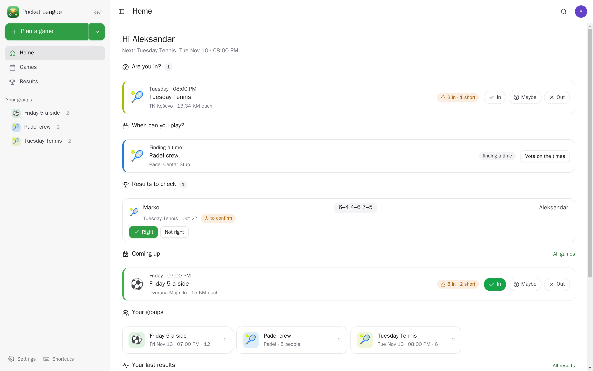
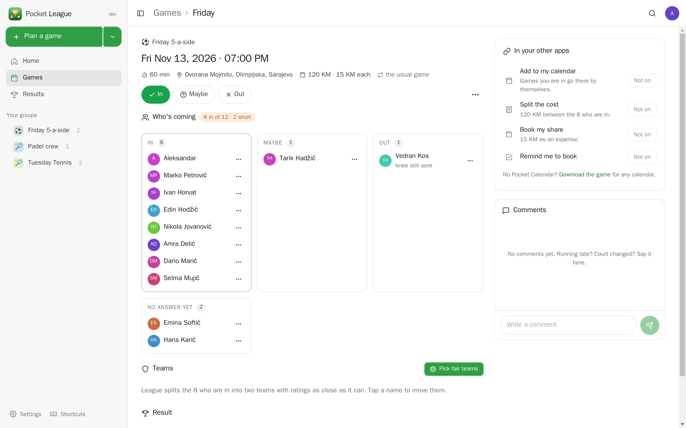
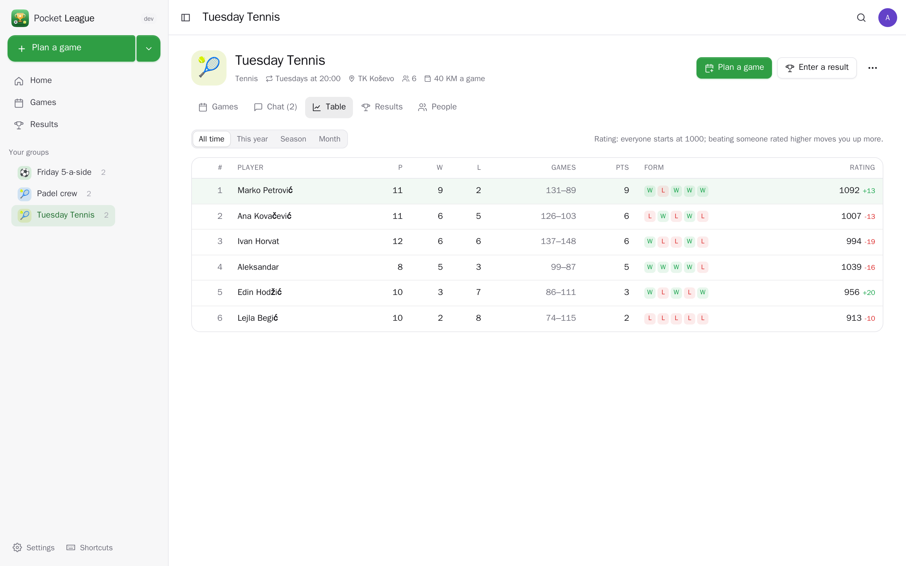
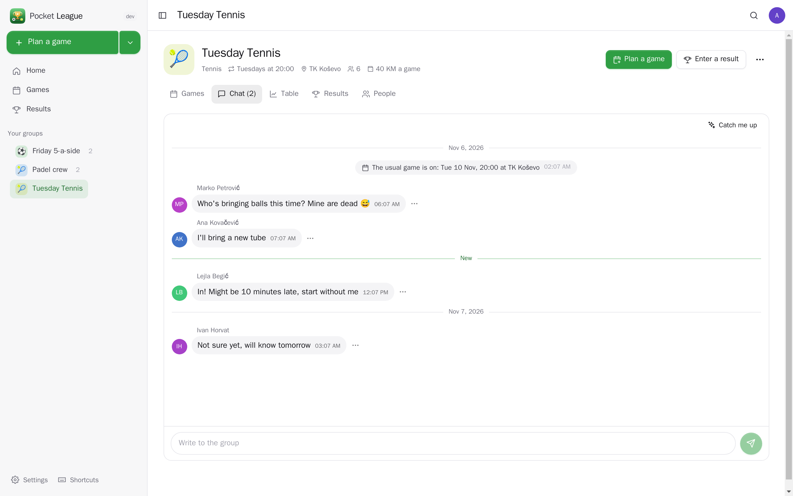
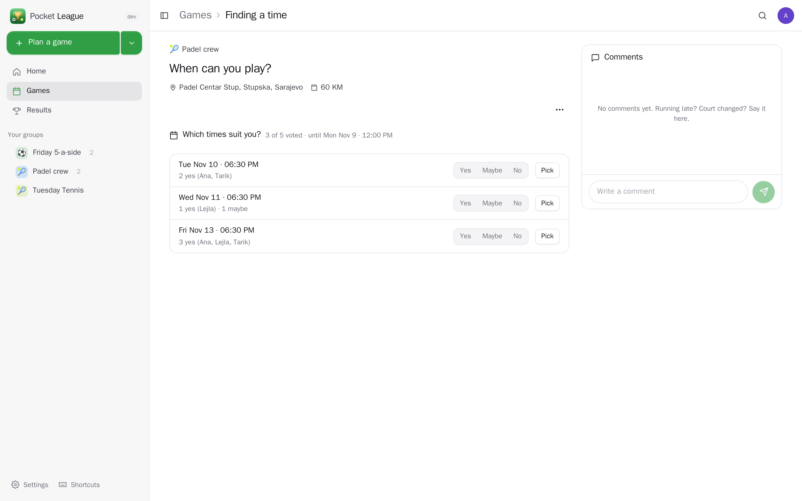
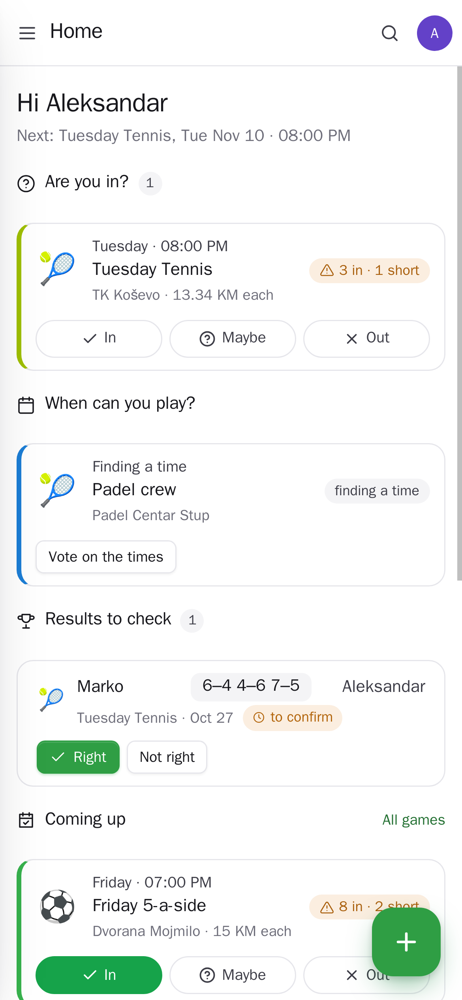
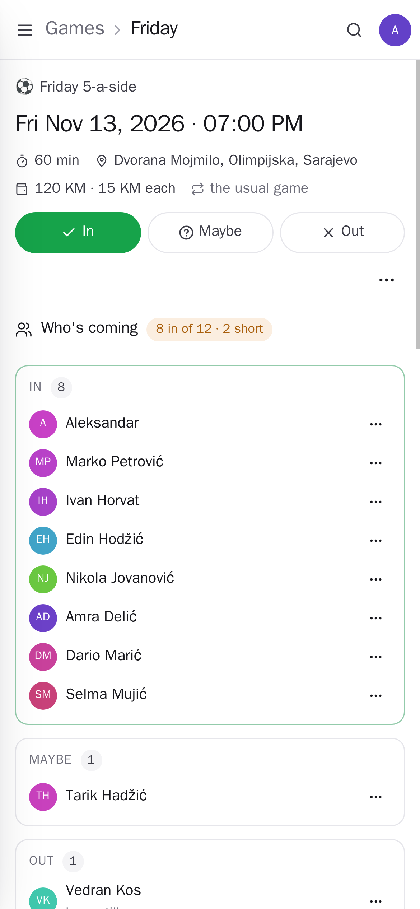

<p align="center"></p>
<h1 align="center">Pocket League</h1>
<p align="center">Sport with friends: a group for each sport you play — tennis on Tuesdays, five-a-side on Fridays, padel when four of you can make it. Plan the next game (or let everyone vote on a time), see who's in with a waiting list when it's full, pick fair teams, enter the score, and watch the table with ratings, form, head-to-head records and player of the game. Every group has a chat, every game its comments. The friends you play with don't need to be on your server: they get an account and a one-time sign-in link by email or WhatsApp — no password, nothing to install.<br>One Go binary, one SQLite file, one volume. Part of the Pocket apps; works on its own too.</p>
<p align="center">
  <a href="https://github.com/abjelosevic88/pocket-homelab-league/actions"></a>
  <a href="https://github.com/abjelosevic88/pocket-homelab-league/pkgs/container/pocket-homelab-league"></a>
  <a href="LICENSE"></a>
</p>

---

<p align="center"></p>

<table>
  <tr>
    <td width="50%"></td>
    <td width="50%"></td>
  </tr>
  <tr>
    <td align="center"><sub>A game: are you in, who's coming (2 short!), fair teams, the score, and the game in your other apps.</sub></td>
    <td align="center"><sub>The table: points, games or goals, form and a rating that moves with every result.</sub></td>
  </tr>
  <tr>
    <td width="50%"></td>
    <td width="50%"></td>
  </tr>
  <tr>
    <td align="center"><sub>The group's chat, with the games and results in between.</sub></td>
    <td align="center"><sub>Finding a time: everyone votes; it settles on the best one by itself.</sub></td>
  </tr>
  <tr>
    <td width="50%"></td>
    <td width="50%"></td>
  </tr>
</table>

## What it does

- **Groups for any sport.** Tennis, padel, badminton, squash, table tennis, volleyball, football, futsal, basketball, handball, hockey, darts, pool, chess, bowling, golf — or your own. Each counts its way: sets (6–4 3–6 7–5), goals or points, only who won, or everyone with their own score (lowest wins for golf). One against one, two against two, teams picked on the day, or everyone on their own.
- **The next game.** Plan it at a time and place, or offer a few times and places and let everyone vote (with "answer by", after which the best one is picked). Each group keeps the places it plays at. Or set the usual day — "Tuesdays at 20:00" — and League plans each game a few days ahead by itself.
- **Who's in.** In / maybe / out in one tap; a full game puts a yes on the waiting list and moves the first one up when someone drops out. Two days before, those who didn't answer are asked; the day before, organisers hear when it's short; everyone who's in gets a reminder (with the weather for outdoor games) and another a few hours before.
- **Fair teams.** Split the people who are in into two teams with ratings as close as possible; shuffle for another fair split; tap a name to move it.
- **Scores and the table.** Anyone enters a result, someone else who played confirms it (or says what's wrong — a disputed result leaves the table until it's fixed; unquestioned ones confirm themselves after two days). The table has points, games or goals for and against, form, streaks, scorers and an Elo-style rating; each player has a page with their rating over time and their record against and with everyone. Player of the game by vote.
- **Chat.** A live chat per group and comments per game, with reactions; League adds a line when a game is planned, moved, cancelled or has a result. The AI never writes in a chat — "Catch me up" and the match report are drafted for you only.
- **Players from outside.** Add someone with an email or a phone number and an account is made for them on the spot. They get a one-time sign-in link — emailed from your mailbox, or sent by WhatsApp, SMS or anything else — and see only their groups. Lost it? They ask for a new one by email. Spond, TeamSnap or a spreadsheet list comes in as a CSV.
- **Any calendar.** Download a game, or subscribe to a group's games in Apple, Google or Outlook calendar.
- **Everyone their own** on one box: groups are shared only by the people in them; admins don't see groups they're not in.

## Run it

```sh
docker run -d --name pocket-league -p 8080:8080 -v ./data:/data \
  -e BASE_URL=https://league.example.com -e SECURE_COOKIES=true \
  ghcr.io/abjelosevic88/pocket-homelab-league:latest
```

or `docker compose up -d` with [docker-compose.yml](docker-compose.yml). Open it, create the first account and make a group. For emails to players, pick your mail server under Settings → Email (or send the links by WhatsApp). All options: [docs/configuration.md](docs/configuration.md). API: [docs/api.md](docs/api.md).

## With Pocket Core

Set `CORE_URL` and `CORE_REGISTRATION_KEY` and League joins the box: people sign in with Pocket Core (a player account with the same email becomes a full member), Pocket AI helps, and through app links each person's games reach their own Pocket apps with nothing to paste:

| App | What League does there | Without it | Scopes |
|---|---|---|---|
| Pocket Calendar | the games you're in, moved or removed when the plan changes; your clashes when voting on a time | download a game, or subscribe to a group's feed | `calendar:read`, `calendar:write` |
| Pocket Health | each match you play as a workout of its sport | — | `health:write` |
| Pocket Habits | ticks your habit ("Sport") on days you play | — | `habits:read`, `entries:write` |
| Pocket Split | splits a game's cost between the players in a Split group | the share per player is shown | `groups:read`, `expenses:write` |
| Pocket Money | books your share as an expense | — | `accounts:read`, `transactions:write` |
| Pocket Weather | the forecast at the court for the game's hours; rain or wind in the reminder | — | `weather:read` |
| Pocket Places | pick the venue from your places, save a new court there | type the venue | `places:read`, `places:write` |
| Pocket Contacts | pick players with their email and phone | type them in | `contacts:read` |
| Pocket Mail | sign-in links, plans and reminders from your own mailbox | your own SMTP server, or WhatsApp/copy | `mail:send` |
| Pocket Tasks | "book the court" a couple of days before a game you plan | — | `tasks:write` |
| Pocket AI | a match report to post, a catch-up of the chat; the Ask button on every page | your own OpenAI key, or no AI | inference |

**Nothing depends on another app.** Each app's state is checked per person — connected, switched off here, switched off in Pocket Core, not on this box, too old — and what needs it is greyed out with one line saying why and what to do, never hidden.

Other apps use League through `league:read` and `league:write`: Pocket Day shows today's game and writes your results into the journal, Pocket Search finds groups, players, games and chat lines, Pocket Weather warns about rain at game time, Pocket AI knows your next game and can say you're in (`league:write` is answering only — no messages, no results). Events on the bus — `league.game_planned`, `league.game_changed`, `league.game_cancelled`, `league.vote_started`, `league.answered`, `league.short`, `league.result`, `league.reminder` — start flows in Pocket Flows. Without Core every connection can be made directly with a URL and a token.

## Develop

```sh
make dev     # API on :8080 with demo data + Vite on :5173
make test    # go vet, go test, tsc
make         # web + binary
```

`node scripts/screenshots.mjs` takes the screenshots above from a demo instance and fails on any browser error. MIT licensed.
